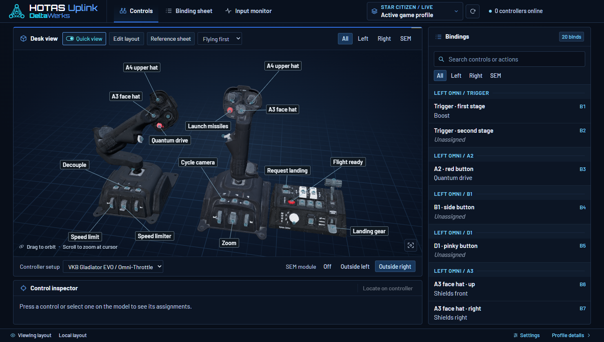

# HOTAS Uplink by DeltaWerks

Configure your flight controls in 3D and apply your bindings to Star Citizen. HOTAS Uplink reads your active game profile, shows each assignment on the physical control, and lets you save, apply and restore layouts. The supported controller setup is the **VKB Gladiator EVO right stick and left Omni-Throttle**, with an optional GNX SEM. The screenshot uses example bindings.

**[Download for Windows x64](https://github.com/Deltawerks/HOTASUplink/releases/latest)**. Under **Assets**, choose the file ending in `-win32-x64.zip`.



## Open the viewer

Extract the Windows ZIP and open **HOTAS Uplink.exe** inside the extracted folder. Keep the executable with its neighboring files. You can browse saved bindings with the controllers unplugged.

For mouse-only editing with software graphics, open **HOTAS Uplink - Compatibility.cmd** in the same folder. This mode skips the Windows joystick reader. You can select controls, search actions and save layouts. Close the app before switching launch modes. From source, use `npm start -- --compatibility-mode`.

The viewer opens the active on-disk game profile and resolves joystick assignments inherited from your installed build. If the game is installed elsewhere, click **Choose LIVE folder…** and select the folder containing `Data.p4k`. When the game has yet to save a profile, save a control change in Star Citizen and use the reload button in HOTAS Uplink. The layout picker also opens named exports, game-supplied VKB presets, or an empty layout.

- In **Controls → Desk view**, use **Controller setup** beneath the models to choose your hardware. **Left**, **Right**, and **SEM** focus the view on one device.
- The viewer opens in **Quick view** on first launch. Each short action label stays pinned beside its control as you rotate the model. Click a label to see its directions, gestures and game contexts. Choose **Edit** beside an input to change it.
- Point at a control and scroll to zoom there. Hat switches show their hardware names in the desk overview. As you zoom in, the visible five-way hats unfold together. Zoom closer for the eight-way POV hats. Click a direction to inspect or edit its binding, or zoom out to fold the groups.
- Use the **Quick view** switch to change views. The app remembers your choice the next time it opens. With Quick view off, press or select a control in **All** to see its assignments. **Locate on controller** turns the camera to the selected control.
- **Reference sheet** gives the annotated controller models the full window. Rotate the models or scroll either column of labels. **Flying first** puts cockpit actions at the top of shared controls. **All contexts** uses the profile order. You can open the sheet during an edit and choose **Back to editing** to resume your draft.
- Search for an action, a control name, or a button number. **Binding sheet** shows every assignment, including actions that share a button across game contexts.
- Open **Settings** at the bottom right and drag **Text size** to resize the interface and Quick view labels. The camera holds its position. The app remembers one percentage across displays.
- **SEM module** starts **Off**. Choose **Outside left** or **Outside right** to add the GNX-SEM beside a stick. The app remembers that placement. Choose each lever's detents in **Settings → SEM lever positions**.
- Turning a center base wheel selects its throttle control. If your stick reports that wheel on a different axis, open **Settings**, choose **Identify wheel** for that stick, and roll it. The app remembers the reported axis for that side.
- Open **Input monitor** to compare the devices Star Citizen saved with the devices Windows sees. Its four-position dial check records the logical button reported when you press B1 in each position.

## Edit and save a layout

1. Choose **Edit layout**. With **Control first**, click a control on the model, choose a hat direction, or press a physical button, then search for the action. With **Action first**, search for an action such as “missile,” select it, then click or press the control you want.
2. Review the assignment. If a layout has no saved joystick slots, choose the appropriate slot for that stick.
3. Choose **Assign** to preview the change. A small **Edited** marker identifies each affected input. You can edit several controls before saving or use **Undo** to reverse the latest assignment.
4. Choose **Save layout for Star Citizen…**, name the layout, and save. The app creates `layout_<name>_exported.xml` in the selected game's `USER/Client/0/Controls/Mappings` directory and opens the new copy.

## Apply a preset and switch back

With Star Citizen closed, open the layout picker and select a **Saved layout** or **Game preset**. Desk view previews its bindings. Choose **Apply for next launch**, then **Apply preset**. Once you see **Ready for next launch**, start the game normally. You can also apply a layout you just saved.

Apply matches the preset's sticks to the devices in the active game profile, including when their joystick slot numbers differ. It replaces the bindings for those sticks and preserves the active keyboard, mouse, other controllers and joystick calibration. If a stick cannot be identified, the app explains which match it needs.

Before each change, HOTAS Uplink saves a dated copy of the entire active `actionmaps.xml` in `USER/Client/0/Profiles/default/HOTAS-Uplink-backups` under the selected installation. To switch back, close the game, open the layout picker, and choose **Restore previous bindings…** under **Binding backup**. Choose the backup you want and confirm. Restoring brings back all control settings in that snapshot, including keyboard or mouse settings you may have changed since.

While the game is running, you can still save a named layout and import it under Star Citizen's **Options → Keybindings → Joystick / HOTAS → Advanced Controls Customization → Control Profiles**. After the game saves its settings, **Check active bindings** compares your named layout with the active bindings on disk. [RSI profile import guide](https://support.robertsspaceindustries.com/hc/en-us/articles/360000183328-Create-export-and-import-custom-profiles)

## Run from source

For an input audit, start with the Windows reader. It opens VKB game controllers through DirectInput and reports button, hat and axis events to the app. Compatibility mode skips this reader. The game profile reader and backup writer show which local Star Citizen files the app reads or changes. [Controller reader](src/input/VkbReader.cs) · [Game profile reader](src/game/profile.cjs) · [Backup and restore](src/game/active-files.cjs)

Use 64-bit Windows and Node.js 24 with npm. From the project directory, run

```powershell
npm ci
npm start
```

The Windows build uses the .NET Framework 4.x C# compiler and the Windows `tar.exe` utility. The three finished models in `assets/rig/` ship in the Windows ZIP with their textures embedded. Raw capture photos, working scans, personal bindings and backups stay out of the release.

| Command | Result |
| --- | --- |
| `npm test` | Runs the profile, backup/restore, input and UI logic tests using disposable data. |
| `npm run build` | Packages the local Windows app and prints its path. |
| `npm run build -- --public` | Creates a portable Windows ZIP in `dist/` with all three textured models and third-party notices. |

For a hardware mapping report, include the game build, which stick hosts the SEM, the control you moved, and what **Input monitor** displayed. Those details help reproduce a slot or axis mismatch.

To propose a new controller setup, include the exact model names, photos from several angles of each controller, and a named Star Citizen layout exported for those devices. An owner can then verify that each physical button, hat and axis matches its on-screen label.

## License

HOTAS Uplink is source-available. The PolyForm Noncommercial License 1.0.0 covers the code and finished controller models supplied by DeltaWerks. You can inspect the source, build the app, and share your own improvements for noncommercial purposes. For commercial distribution or resale, contact DeltaWerks for a separate license. Third-party components retain their own licenses. [Project license](LICENSE) · [Third-party notices](ASSET-NOTICES.md)

Required Notice: Copyright 2026 DeltaWerks.

